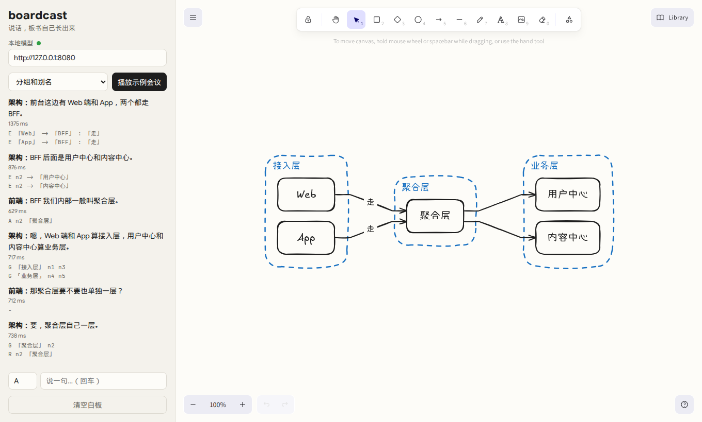

# boardcast

**说话，板书自己长出来。** 会议里大家只管讨论，白板上的手绘示意图跟着对话实时生长。全部在本机运行，不上传音频，不调用云端模型。

> Talk, and the whiteboard draws itself. Local-first live meeting diagrams: speech → a small local LLM emitting graph edits → deterministic layout → hand-drawn Excalidraw board. Runs on Linux, Windows (x64 / ARM64), and later macOS.

现在是早期原型：文字输入和示例会议回放已经能用，语音输入还在做。



## 它怎么工作

```
麦克风 / 系统声音 ──► 流式转写 ──► 一句话说完
                                    │
              ┌─────────────────────┴─────────────────────┐
              ▼                                           ▼
        快车道（规则，<10ms）                       慢车道（本地小模型）
   提到已有节点就高亮；                          读「实体表 + 前两句 + 新的一句」，
   「画一下 A 到 B」直接出铅笔稿                  只输出几行图操作（语法约束）
              │                                           │
              └──────────────► 图状态 ◄────────────────────┘
                     （铅笔稿被模型确认就描成墨线，否则擦掉）
                                    │
                         ELK 自动排版 → Excalidraw 手绘渲染
```

关键设计：

- **模型不画图，只发操作。** `E 甲 -> 乙 : 「标签」`、`X`（删线）、`R`（改名）、`A`（别名）、`G`（分组）、`D`（删节点）。排版和画风全部是确定性代码。
- **实体表管记忆。** 「它」「那边」「那个服务」靠程序维护的节点表和别名对上，模型只需要在列表里挑编号。
- **语法约束解码。** 每次调用按当前白板生成 GBNF，编号只能从已有节点里选，小模型写不出不存在的东西。
- **前缀缓存。** 系统提示词和示例对话固定在最前面，llama-server 复用它们的 KV，每句话只需重新读入一百个左右的 token。
- **忙时合并。** 模型同一时间只跑一个请求，排队的句子下一轮合并处理，板书不会越拖越晚。

## 目前的评测

`eval/cases.json` 里有 10 段合成会议（纠正、指代、闲聊噪声、分组、改名、删方案、中英混说、口令）。在 RTX 3060 Laptop 上的结果：

| 模型 | 节点 F1 | 连线 F1 | 分组 | 单句延迟 p50 / p95 |
|---|---|---|---|---|
| Qwen3.5-2B Q4 | 0.53 | 0.22 | 0.00 | 210 / 430 ms |
| 9B（Qwen 系微调）Q4 | 0.95 | 0.83 | 1.00 | 526 / 972 ms |

注意：这 10 段用例同时被用来调提示词，分数偏乐观。下一步要补一套不参与调参的测试集，再用合成数据给 2B–4B 的模型做 LoRA 微调，目标是让小模型接近 9B 的准确率。

## 本地运行

需要 Node 24+、pnpm、Rust（打包桌面版时）和 [llama.cpp](https://github.com/ggml-org/llama.cpp)。

```sh
pnpm install

# 1. 起一个本地模型（任意 GGUF；有显卡就加 -ngl 99）
llama-server -m path/to/model.gguf --port 8080 -c 4096 --jinja -np 1

# 2. 网页版
pnpm dev            # http://localhost:1420

# 3. 或者桌面版
pnpm tauri dev
```

跑评测：

```sh
pnpm eval -- --label my-model          # 报告写到 eval/reports/
node eval/run.ts --only login-flow -v  # 看某一段的逐句操作
pnpm test                              # 引擎单元测试，不需要模型
```

## CI

- `CI`：类型检查、单元测试、网页构建，然后在 Linux x64、Windows x64、Windows ARM64 上打桌面安装包。
- `Board eval`：改了 `src/engine` 或 `eval` 时，在 CPU 机器上用 llama.cpp 跑一遍评测，分数写进 job summary，用来看回归。
- `Release`：推 `v*` tag 时三平台打包，生成草稿 Release。

## 路线

- [x] 文字 → 图操作 → 手绘板书，评测和延迟统计
- [ ] sherpa-onnx 流式转写（麦克风 + 系统声音）
- [ ] Tauri 外壳拉起 llama-server，首次启动下载模型
- [ ] 不参与调参的测试集；合成数据 + LoRA 微调小模型
- [ ] 增量排版，新节点出现时旧节点不跳
- [ ] 导出 Markdown / PNG / `.excalidraw`
- [ ] macOS 构建

## 许可

MIT
