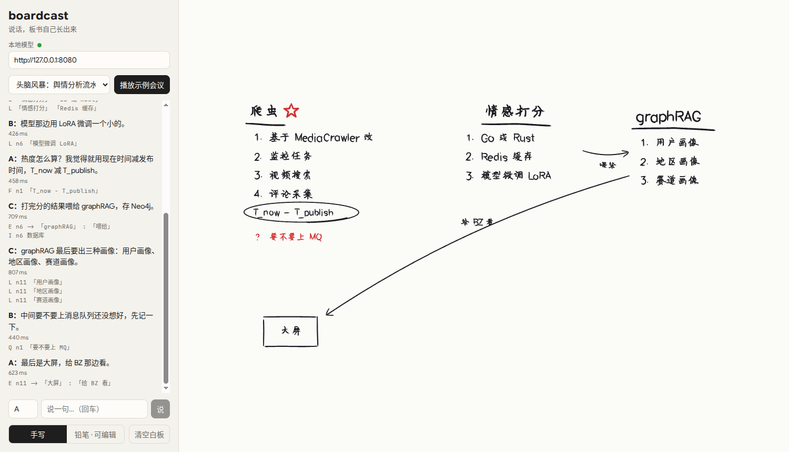
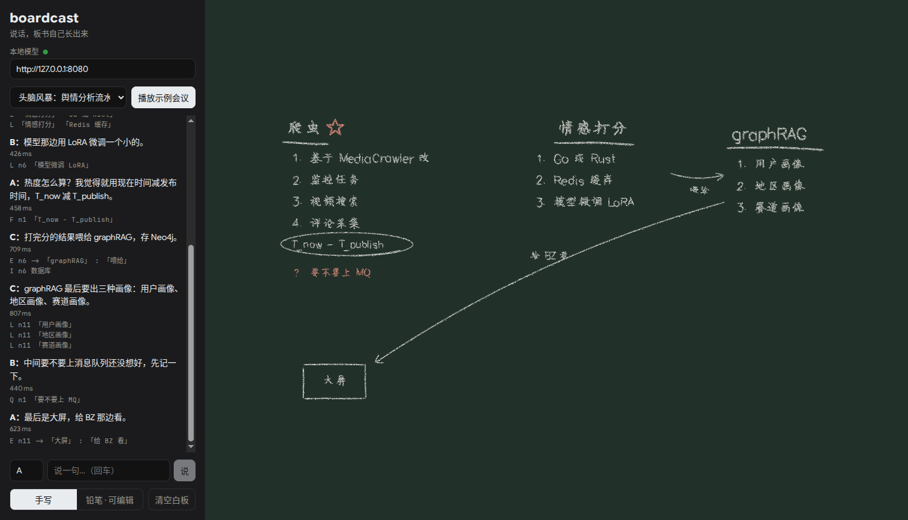
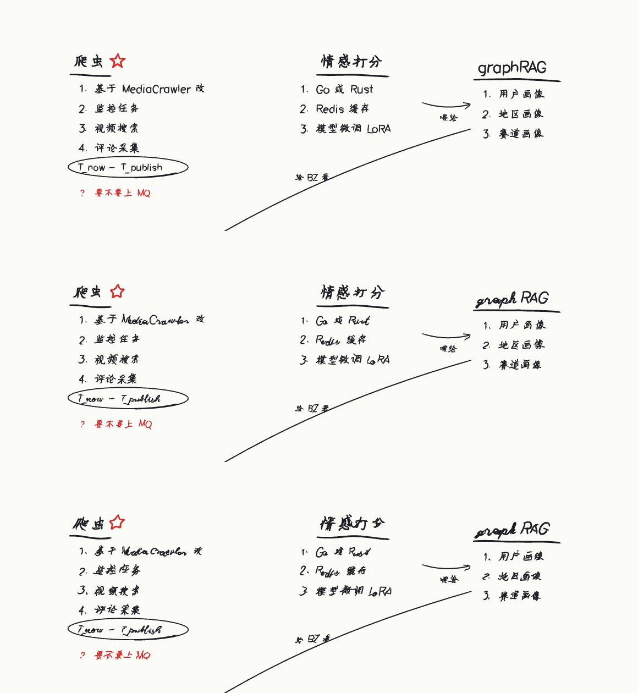
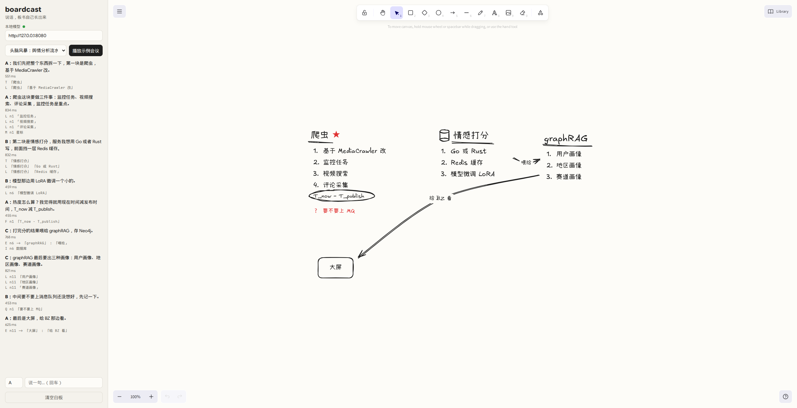
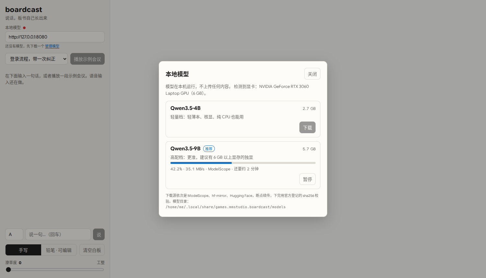

# boardcast

**说话，板书自己长出来。** 会议里大家只管讨论，白板上的手绘示意图跟着对话实时生长。全部在本机运行，不上传音频，不调用云端模型。

> Talk, and the whiteboard draws itself. Local-first live meeting diagrams: speech → a small local LLM emitting graph edits → deterministic layout → hand-drawn Excalidraw board. Runs on Linux, Windows (x64 / ARM64) and macOS (Apple Silicon).

现在是早期原型：桌面版可以直接对着麦克风说话出板书，也可以打字或回放示例会议。

板书有两种风格，左下角切换：

- **手写**：像有人拿马克笔在白板上写（深色主题下是黑板粉笔）。汉字按笔顺一笔一笔写出来。下面的「潦草度」滑杆从工整调到龙飞凤舞，同时控制字的歪斜、大小和基线起伏、整体右倾、手抖、笔画错位和磨圆、字距；过半以后汉字会带出连笔，英文小写换成连写体（大写和数字保持印刷体，免得认不出来）。
- **铅笔 · 可编辑**：Excalidraw 的手绘风格，可以直接在板上拖动、修改、补画。









## 它怎么工作

```
麦克风 / 系统声音 ──► 流式转写 ──► 一句话说完
                                    │
              ┌─────────────────────┴─────────────────────┐
              ▼                                           ▼
        快车道（规则，<10ms）                       慢车道（本地小模型）
   提到已有节点就高亮；                          读「实体表 + 前两句 + 新的一句」，
   「画一下 A 到 B」直接出铅笔稿                  只输出几行图操作（语法约束）
              │                                           │
              └──────────────► 图状态 ◄────────────────────┘
                     （铅笔稿被模型确认就描成墨线，否则擦掉）
                                    │
        要点按区域摆放 + 流程图用 ELK 排版 → 手写笔迹 / Excalidraw 渲染
```

关键设计：

- **模型不画图，只发操作。** 排版和画风全部是确定性代码。操作分两类：
  - 流程图：`E 甲 -> 乙 : 「标签」`（连线）、`X`（删线）、`G`（分组）；
  - 要点板：`T`（话题）、`L`（条目，可以多层，也用来把条目挪到别处）、`Q`（待定问题）、`F`（公式）、`K`（备注）、`M`（划掉、圈出、下划线、星标）、`I`（从图标库里挑一个小图标）；
  - 通用：`R`（改名）、`A`（别名）、`D`（删除）。
  一块板上两类可以并存、互相连线。方案被否掉时默认划掉而不是擦掉，更像真实板书。
- **实体表管记忆。** 「它」「那边」「那个服务」靠程序维护的节点表和别名对上，模型只需要在列表里挑编号。
- **语法约束解码。** 每次调用按当前白板生成 GBNF，编号只能从已有节点里选，小模型写不出不存在的东西。
- **前缀缓存。** 系统提示词和示例对话固定在最前面，llama-server 复用它们的 KV，每句话只需重新读入一百个左右的 token。
- **手写是真的「写」出来的。** 不是套手写字体：汉字用 [hanzi-writer-data](https://github.com/chanind/hanzi-writer-data) 里按笔顺排好的骨架线，英文数字用 Hershey 单线字体（印刷体 futural，潦草时小写换成连写体 scripts），再交给 [perfect-freehand](https://github.com/steveruizok/perfect-freehand) 模拟马克笔的压感和收笔。新内容用骨架线做遮罩逐笔描出来；一轮新内容最多写 2.4 秒，写不完就整体加速，板书不会落后于讨论。
- **忙时合并。** 模型同一时间只跑一个请求，排队的句子下一轮合并处理，板书不会越拖越晚。

## 目前的评测

`eval/cases.json` 里有 17 段合成会议：10 段流程图向（纠正、指代、闲聊噪声、分组、改名、删方案、中英混说、口令），7 段头脑风暴向（拆模块、分工调整、方案对比、复盘、定价公式、流程图混待办、改条目）。在 RTX 3060 Laptop（6 GB）上，各模型都用 Q4_K_M 量化：

| 模型（均为 Apache 2.0） | 大小 | 节点 F1 | 连线 F1 | 话题召回 | 要点 F1 | 标记命中 | 延迟 p50 / p95 |
|---|---|---|---|---|---|---|---|
| Qwen3.5-2B | 1.3 GB | 0.68 | 0.33 | 1.00 | 0.44 | 0.50 | 269 / 737 ms |
| Gemma 4 E2B | 3.1 GB | 0.83 | 0.45 | 0.64 | 0.37 | 0.26 | 295 / 739 ms |
| **Qwen3.5-4B**（轻量档） | 2.7 GB | 0.88 | 0.58 | 0.90 | 0.54 | 0.64 | 382 / 653 ms |
| Gemma 4 E4B | 5.0 GB | 0.87 | 0.69 | 0.88 | 0.69 | 0.69 | 347 / 657 ms |
| **Qwen3.5-9B**（高配档） | 5.7 GB | 0.88 | 0.77 | 1.00 | 0.73 | 0.88 | 551 / 999 ms |

要点 F1 指条目挂在对的话题下面；标记命中包括划掉、强调、问题、公式。选型的理由见 #4。

已知问题（都已经记成 issue，见 [Issues](https://github.com/HsiangNianian/boardcast/issues)）：
- 这 17 段用例同时被用来调提示词，分数偏乐观；
- 「大量闲聊里夹着两句有用的」那段，模型把有用的两句也当成闲聊跳过了；
- 模型偶尔把标记打在错的编号上（比如星标打在话题上而不是条目上）；
- 2B 模型在新版用例上的分数以 CI 的评测结果为准，只用来看回归。

下一步：补一套不参与调参的测试集，再用合成数据给 2B–4B 的模型做 LoRA 微调，目标是让小模型接近 9B 的准确率。

## 桌面版和模型

桌面版安装包里自带 llama.cpp 的 llama-server（Vulkan 版，N 卡、A 卡、Intel 核显、骁龙 Adreno 都能用，没有可用显卡时自动退回 CPU），启动时自动拉起，不用开终端：

- 有独显就只用独显；核显和独显同时存在时不会把模型拆到两张卡上。
- 显存放不下整个模型（比如 6 GB 的卡跑 9B，或者显存被别的程序占了一部分）时，按剩余显存放尽量多的层，其余留在 CPU，而不是整个退回 CPU。
- 应用崩溃或被强制结束时，llama-server 会跟着退出，不会留下占着显存的进程。
- 首次加载后会先空跑一次预热。每台机器第一次启动时 Vulkan 要编译着色器，可能要等几十秒，之后会被驱动缓存。

第一次打开时会弹出「本地模型」面板，按显卡推荐一档：

| 模型 | 大小 | 适合 |
|---|---|---|
| Qwen3.5-4B（Q4_K_M） | 2.7 GB | 轻薄本、核显、纯 CPU |
| Qwen3.5-9B（Q4_K_M） | 5.7 GB | 6 GB 以上显存的独显 |

下载依次尝试 ModelScope（直连，不走系统代理）、hf-mirror、Hugging Face；断点续传，可以暂停；下完用 Hugging Face 上登记的 sha256 校验，然后自动切换过去。之后随时可以点「管理模型」切换或删除。



也可以手动把任意 `.gguf` 放进模型目录，或者用环境变量 `BOARDCAST_MODEL=/path/to/model.gguf` 指定：

| 系统 | 模型目录 |
|---|---|
| Linux | `~/.local/share/games.mmstudio.boardcast/models/` |
| Windows | `%APPDATA%\games.mmstudio.boardcast\models\` |

llama-server 的日志在应用的日志目录里（Linux 是 `~/.local/share/games.mmstudio.boardcast/logs/llama-server.log`）。

下载前会先看模型目录所在的盘还剩多少空间，不够就直接提示还差多少，不会下到一半才报错。

### 语音输入

在「本地模型」面板里下载「语音识别」（0.2 GB），然后点「开始收音」直接说话：

- 麦克风由桌面外壳用 cpal 采集，转成 16 kHz 后交给 Silero VAD 断句；停顿约 0.45 秒算一句话说完。
- 每句话交给 SenseVoice（中英日韩粤，自带标点和数字规整）识别，结果直接进板书；说话过程中每 0.6 秒刷新一次灰色的临时字幕。
- 一句 5.6 秒的话，识别只要两三百毫秒（三个平台的 CI 上实测）。
- 在「设置」里可以选用哪个麦克风（Linux 上走 PulseAudio / PipeWire，列出的是真实的输入设备）；选的麦克风拔掉了会自动退回系统默认。
- 目前只收麦克风；线上会议里别人的声音（系统声音）和区分说话人还没做，说话人用输入框左边那个名字。

### 远程模型（OpenAI 兼容接口）

不想用本地模型，或者想用更大的模型时，在「设置 → 远程模型」里填 Base URL、API Key 和模型名（OpenAI、DeepSeek、通义千问、vLLM、LM Studio、Ollama 等兼容 `/chat/completions` 的服务都行）：

- 点「保存并启用」时会先真发一条请求确认能连上，连上了才启用；之后每次打开应用也会先检查一遍。
- 启用后优先用它出板书；某一句请求失败时，这一句自动改用本地模型，界面上会标出来。
- 只发 OpenAI 标准字段，另外会试着关掉推理模型的思考模式；服务不认这个参数时自动去掉重试，并记住。
- 桌面版的请求由外壳代发，key 存在应用配置目录的 `remote.json`（Linux 上权限 0600），不进网页，界面上只显示首尾几位。网页版只能存在浏览器里，而且很多服务商不允许浏览器直接调用，建议用桌面版。
- 远程接口没有本地那样的输出语法约束，效果取决于模型本身。

### 排版不乱跳

会开到一半，已经写上去的东西不该挪地方：

- 话题、待定这些区域记住自己的位置，新区域找一块空地放，尽量让整块板保持横向；某块区域长大压到别人时，只把后出现的往下推。
- 流程图只在第一次整体排；之后旧节点原地不动，新节点放在它连着的节点旁边（上游在左、下游在右），被占了就上下找空位，也不会长到别的区域里去。两端都没动的连线保持原来的走线。
- 新内容还在画面里时视角不动，跑出画面才重新缩放。
- 时间长了留下空洞或者绕远的线，点顶栏的「整理排版」整块重新排一次。

### 导出

顶栏的导出按钮（板上有内容时可用）：

- **Markdown**：会议名作标题，有摘要时摘要放在最前面；话题写成标题加编号条目（划掉、圈出、星标会保留），流程图写成 Mermaid，最后附上会议记录。
- **PNG**：看到什么导出什么。手写模式按内容范围裁切、2 倍清晰度，白板 / 黑板跟着当前主题；铅笔模式包含你手动改过的内容。
- **SVG**：矢量图，放大不糊，可以插进文档或者用矢量软件接着改；手写模式保留粉笔 / 马克笔的质感。
- **Excalidraw**：`.excalidraw` 文件，可以拖进 [excalidraw.com](https://excalidraw.com) 接着改。

桌面版会弹系统的另存为对话框，网页版直接下载。

### 界面

- 白板铺满整个窗口；说话和打字都在底部的一条输入栏里：左边是收音按钮（收音时旁边显示实时波形），中间打字。输入框前面的小标签是当前说话人，点一下轮换，或者在句首写 `@名字 ` 直接换人（新名字也行），记录里的头像同色。说话时的临时字幕浮在栏上方。输入栏可以收起，按 `/` 随时回到输入框；示例会议在空白板的引导里。
- 右边是会议记录，每句话点开能看到它生成的板书操作，不需要时可以收起。
- 会议记录栏顶上的「摘要」：用当前在用的模型（开了远程就用远程，失败退回本地）按会议记录和板书写出结论、决定、待办（带负责人）、待讨论。会开得长时先分段记要点再合成。摘要可以直接改，跟着会议一起保存，导出 Markdown 时放在最前面。用远程模型时会议记录会发到那个接口，按钮的提示里会写明。
- 本地 / 远程模型、麦克风、潦草度在右上角的「设置」里；旁边的按钮在跟随系统、浅色、深色之间切换主题。
- 会议自动保存（桌面版存在应用数据目录的 `meetings/` 下，网页版存在浏览器里），关掉再打开会接着上次那场；顶栏字标旁边是当前会议的名字，点开可以打开、重命名、删除以前的会议。顶栏的「+」开一场新会议。
- 手写模式里可以直接改：点一下框、条目、话题标题或连线就选中它，浮出「改字 / 划掉 / 圈出 / 星标 / 删除」；`Delete` 删除，`Ctrl+Z` / `Ctrl+Shift+Z` 撤销、重做（模型画的和手动改的都能撤）。选中的框或话题可以按住拖到别处，话题下面的条目跟着走，连线自动重新走线；拖动也能撤销。手动改动会记进会议记录，模型下一句看到的也是改过的板。
- 启动时用板书同一支笔把 boardcast 写出来，点一下或按任意键跳过；系统开了「减少动态效果」时只淡出。
- 手机上强制横屏：能锁定方向的浏览器直接锁成横屏，锁不了的（比如 iOS Safari）竖着拿时把整个界面转 90 度显示。铅笔模式的编辑在转过来的界面里指针位置不准，要编辑请把手机真的横过来。

## 本地运行

需要 Node 24+、pnpm 和 Rust（打包桌面版时）。

```sh
pnpm install

# 桌面版：会自动下载对应平台的 llama-server 到 src-tauri/llama/
pnpm tauri dev

# 只跑网页版时，需要自己起一个 llama.cpp 的服务（任意 GGUF；有显卡就加 -ngl 99）
llama-server -m path/to/model.gguf --port 8080 -c 4096 --jinja -np 1
pnpm dev            # http://localhost:1420
```

跑评测：

```sh
pnpm eval -- --label my-model          # 报告写到 eval/reports/
node eval/run.ts --only login-flow -v  # 看某一段的逐句操作
pnpm test                              # 引擎单元测试，不需要模型
```

## CI

- `CI`：类型检查、单元测试、网页构建，然后在 Linux x64、Windows x64、Windows ARM64、macOS（Apple Silicon）上打桌面安装包。
- `Board eval`：改了 `src/engine` 或 `eval` 时，在 CPU 机器上用 llama.cpp 跑一遍评测，分数写进 job summary，用来看回归。
- `Release`：推 `v*` tag 时，用 CHANGELOG.md 里这个版本的那一节当 Release 正文，三平台打包并把安装包传上去，全部成功后正式发布。

## 发版

提交信息遵循[约定式提交](https://www.conventionalcommits.org/zh-hans/)（`feat(scope): …`、`fix: …`、`docs: …`），发版时据此自动生成更新日志：

```sh
pnpm release 0.2.0 --dry-run   # 先看看这一版的更新日志长什么样，不改任何文件
pnpm release 0.2.0             # 改版本号、把这一版写到 CHANGELOG.md 最前面、提交并打 tag v0.2.0
pnpm release 0.2.0 --push      # 同上，再推送提交和 tag，触发 Release 工作流
```

- 版本号同时改 `package.json`、`src-tauri/Cargo.toml`、`src-tauri/Cargo.lock`、`src-tauri/tauri.conf.json`。
- 更新日志按类型分组（Features、Fixes、Documentation、Build and CI……），提交正文里的 `- ` 要点会保留成子条目，每条附提交链接，最后附上和上一版的对比链接。
- 不加 `--push` 时可以先手动改 CHANGELOG.md 里的措辞再推；Release 正文用的就是推上去的那一节。
- 直接手推的 tag（CHANGELOG.md 里没有这一版）也能发：正文按上一个 tag 以来的提交现生成。
- 带后缀的版本（如 `-rc.1`）标为预发布，其余（包括 0.x）是正式版。某个平台打包失败时 Release 留在草稿，修好后在 Actions 里对这个 tag 手动重跑。

## 路线

- [x] 文字 → 图操作 → 手绘板书，评测和延迟统计
- [x] 要点板：话题、多层条目、问题、公式、备注、划掉 / 圈出 / 星标、小图标
- [x] 手写模式：按笔顺逐笔书写，白板马克笔 / 黑板粉笔，潦草度可调
- [x] 手写模式里的小图标
- [x] 导出 SVG
- [x] 语音输入：麦克风 → Silero 断句 → SenseVoice 识别（带标点），说话时有临时字幕
- [ ] 系统声音（线上会议里别人的声音）、区分说话人
- [x] Tauri 外壳拉起打包进来的 llama-server（#2）
- [x] 首次启动下载模型（#3）
- [x] 设置页、深浅色主题、自定义 OpenAI 兼容接口（本地兜底）、选择麦克风
- [ ] 不参与调参的测试集；合成数据 + LoRA 微调小模型
- [x] 增量排版，新节点出现时旧节点不跳
- [x] 导出 Markdown / PNG / `.excalidraw`
- [x] macOS 构建（Apple Silicon，Metal 版 llama-server）；安装包还没签名，第一次打开要在「系统设置 → 隐私与安全性」里允许

## 许可

代码 MIT。

手写模式用到的汉字笔画数据来自 hanzi-writer-data（源自 Make Me a Hanzi 与 Arphic 字体），使用 Arphic Public License，许可文本会随数据一起放进 `public/hanzi/ARPHICPL.TXT`。Hershey 字体数据来自 hersheytext（MIT）。
