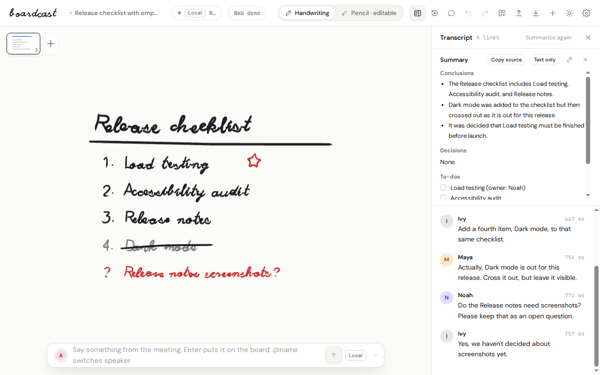

<div align="center">

# boardcast

**Talk, and the whiteboard draws itself.**

Local speech recognition · Live hand-drawn boards · Meeting replay and export

[Website](https://hsiangnianian.github.io/boardcast/) · **[Download the desktop app](https://github.com/HsiangNianian/boardcast/releases/latest)** · [Changelog](CHANGELOG.md)

[](https://github.com/HsiangNianian/boardcast/releases/latest) [](https://github.com/HsiangNianian/boardcast/actions/workflows/eval.yml) [](LICENSE)

**English** · [中文](README.zh.md)

</div>

<picture>
  <source media="(prefers-color-scheme: dark)" srcset="docs/screenshot-chalk-en.png">
  
</picture>
<p align="center"><sub>A board from the previous app. The current app draws the same boards; the window around them looks different.</sub></p>

boardcast turns a discussion into a growing whiteboard. Flows, notes, assignments, questions and rejected proposals are written, connected and crossed out as the conversation goes. Import a paper or a screenshot to discuss and mark up the source itself.

Speech recognition and the board model run on your computer by default. Once the models are downloaded, you can work offline. You can also connect an OpenAI-compatible API for a larger model.

The desktop app is a native rewrite in Rust on [GPUI](crates/README.md). The earlier Tauri app is no longer released, and a few of its features are [not in the current app yet](#not-in-this-app-yet).

[Get started](#get-started) · [What you can do](#what-you-can-do) · [Shortcuts](#shortcuts) · [Models and privacy](#models-and-privacy) · [Development](#development-and-evaluation)

## Get started

1. Download a package from [Releases](https://github.com/HsiangNianian/boardcast/releases/latest). They hold the same app and differ in the speech models inside:

   | Package | Recognizes | Speech models |
   |---|---|---|
   | `…-macos.zip`, `…-linux.tar.gz` | Japanese, English and Chinese, each with its best model | about 1.1 GB |
   | `…-ja` | Japanese, with ReazonSpeech | about 160 MB |
   | `…-en` | English, with Parakeet | about 660 MB |
   | `…-sensevoice` | Chinese, English, Japanese, Korean and Cantonese, with SenseVoice | about 230 MB |
   | `…-macos-apple.zip` | Whatever your Mac's own recognizer supports | none |

   Packages are built for macOS on Apple Silicon and for Linux x64. There is no Windows package of the current app yet.

2. **macOS:** the app is signed only ad hoc, so open it with Control-click › Open the first time. **Linux:** unpack the archive and run `./install.sh` (into `~/.local`, no root needed; `--uninstall` removes it and keeps your data). Later versions then install themselves.
3. On first launch, Settings opens on **Board model**: download a model that runs on this computer, or set up a remote one. Speech recognition is already included.
4. Click **Start listening** (or press `Space`), or type a line in the transcript's input and press Enter.

An installed copy looks for a new version shortly after starting. It installs in the background and waits for you to restart, so a meeting is never interrupted.

## What you can do

| During the discussion | After the discussion |
|---|---|
| **Talk and draw**: flows, topics, nested items, questions, formulas and notes share one board. | **Summarize**: collect conclusions, decisions and to-dos into a summary you can edit, tick off and copy. |
| **Circle and refer**: circle things, then say "connect these two" or "star this", and the model knows what you mean. | **Replay and fork**: watch the board grow, seek, change speed, or start a new board from any recorded moment. |
| **Correct the board**: select something to strike, circle, underline, star or highlight it, change its words or remove it. Undo and redo cover all of it. | **Trace who said what**: hover a speaker to see their part of the board; jump from an item to the line behind it. |
| **Tell speakers apart** by voice and give them real names; the same voice keeps its name. | **Find a meeting** again in the meeting list and carry on where it stopped. |

Boards are drawn stroke by stroke in Chinese, Japanese and English. Light mode uses whiteboard markers; when the system is dark, the board becomes a chalkboard. The interface is in English or Chinese, following the system or your choice in Settings; board labels and summaries follow the meeting's language.

### Circle and refer

Click the lasso in the bottom bar, then drag around things on the board. Draw as many loops as you like; everything with its middle inside a loop is taken in, up to eight. The next line, spoken or typed, carries those targets to the model, and the circles go away. `Esc` or the lasso cancels. Circles never become part of the board or its exports.

### Discuss your source material

Use **Import** or drop a file on the board:

| Source | What you can do |
|---|---|
| **PDF / papers** | One board per page with the page underneath. Mark words, sentences and paragraphs; link regions and add notes. |
| **arXiv** | Paste a link or paper ID to download the PDF. |
| **PNG / JPEG / WebP / GIF** | Read the text in a screenshot or a photographed whiteboard with the local vision add-on. |

### Take the meeting with you

| Export | Use it for |
|---|---|
| **Markdown** | Key points, a Mermaid flow chart and the transcript. |
| **PNG / SVG** | This board, as it looks on screen; SVG stays sharp at any size. |
| **Animated SVG** | This board, written out stroke by stroke in the order of the meeting. |
| **Replay page** | One `.html` file for someone who missed the meeting. Nothing to install. |
| **Whole meeting PDF** | A page per board, then the summary and transcript, with selectable text. |

Exports always use marker on white paper, whatever the window's theme.

### Online meetings and recordings

In **Settings › Speech › Listen to**, choose a microphone or, on Linux, the **Monitor of …** input of the speakers or headphones that play the meeting. That is how the other side of an online call, or a recording playing in a media player, is heard. One input is heard at a time. On a Mac, any package can use Apple's own recognizer instead, from the same section.

### Not in this app yet

These were in the earlier app and have not been rebuilt yet: free editing and export with Excalidraw, the glossary and pronunciation correction ([#117](https://github.com/HsiangNianian/boardcast/issues/117)), hearing the microphone and system audio together, system audio on macOS ([#34](https://github.com/HsiangNianian/boardcast/issues/34)), a Windows package, a global microphone shortcut and the diagnostics bundle.

## Shortcuts

Shortcuts work while the board has focus and leave text fields alone. On macOS, use `Cmd` for `Ctrl`.

| Key | Action |
|---|---|
| `Space` | Start or stop listening |
| `/` | Type a line |
| `Esc` | Clear the circles or the selection, or close the panel |
| `Ctrl+Z` / `Ctrl+Shift+Z` | Undo / redo |
| `Ctrl+=` / `Ctrl+-` / `Ctrl+0` | Zoom in / out / fit the board |
| `Ctrl+Shift+R` | Replay; then `Space` plays or pauses, `←` `→` step and `Esc` leaves |

## Models and privacy

The app bundles llama.cpp's `llama-server` and runs it for you: Vulkan on Linux and Metal on macOS, falling back to the CPU where needed. Choose a board model in **Settings › Board model**:

| Model | Download | Notes |
|---|---|---|
| **Qwen3.5-4B · Q4_K_M** | about 2.7 GB | The default; works on laptops and integrated graphics. |
| **Qwen3.5-9B · Q4_K_M** | about 5.7 GB | Larger; 6 GB of graphics memory or more is recommended. |
| **MiniCPM5-2B**, **MiniCPM5-1B**, **MiniCPM-V 4.7 1B** | smaller | For lighter machines; the app notes each one's limits beside it. |

Downloads can be paused and resumed, check free space and verify SHA-256, trying ModelScope, hf-mirror and Hugging Face in turn. The first start compiles shaders for your graphics card, which takes about half a minute, once.

- **Local by default**: audio is recognized on your computer and meetings stay there. No account or API key is needed.
- **Remote by choice**: under **Remote**, enter an OpenAI-compatible address, model and key, or fill in DeepSeek with one click, then **Test** and **Save**. Lines, speaker names and board text go to that service; audio does not.
- **Key storage**: the key is kept in `remote.json` in the settings folder, readable only by you, and never logged.

| | Meetings and models | Settings (`remote.json`) |
|---|---|---|
| Linux | `~/.local/share/games.mmstudio.boardcast/` | `~/.config/games.mmstudio.boardcast/` |
| macOS | `~/Library/Application Support/games.mmstudio.boardcast/` | the same folder |

`BOARDCAST_DATA` and `BOARDCAST_CONFIG` move them elsewhere.

## Development and evaluation

The desktop app is a Cargo workspace; [crates/README.md](crates/README.md) describes each crate. On Linux, install the packages the CI installs: `pkg-config libxkbcommon-dev libxkbcommon-x11-dev libwayland-dev libx11-xcb-dev libxcb1-dev libvulkan-dev libasound2-dev libssl-dev libzstd-dev libfontconfig-dev libfreetype-dev` on Debian or Ubuntu.

```sh
git clone https://github.com/HsiangNianian/boardcast.git
cd boardcast
cargo run --release -p boardcast-ui     # the desktop app
cargo test --workspace
sh packaging/linux/package.sh           # target/package/boardcast-<version>-<arch>-linux.tar.gz
```

Everything is Rust, the website included: it is built with [Trunk](https://trunkrs.dev) (`cd landing && trunk serve`); see [landing/README.md](landing/README.md).

<details>
<summary><strong>Evaluation</strong></summary>

| Set | Current size | Purpose |
|---|---|---|
| [`eval/cases.json`](eval/cases.json) | 28 meetings | Development and regression, including English and a real-meeting regression |
| [`eval/holdout.json`](eval/holdout.json) | 27 meetings | Held out from prompt tuning |
| [`eval/pointing.json`](eval/pointing.json) | 18 cases | Chinese and English pointing cases with fixed starting boards |
| [`eval/revisions.json`](eval/revisions.json) | 3 cases | Transcription revisions that must keep node identity and unrelated content; not run until the GPUI app revises transcripts |

Start a working llama-server, then run:

```sh
cargo run --release -p boardcast-tools -- agent-eval . board.json --llm http://127.0.0.1:8080 --set dev --label my-model
cargo run --release -p boardcast-tools -- agent-eval . board.json --llm http://127.0.0.1:8080 --set holdout --label my-model
cargo run --release -p boardcast-tools -- agent-eval . board.json --llm http://127.0.0.1:8080 --set pointing --repeat 3 --label my-model
```

Speech recognition has its own suites:

```sh
cargo build --release -p boardcast-asr-eval
target/release/asr-eval download . --suite quick   # fetch and verify the recordings, and write a listening page
target/release/asr-eval run . --suite quick        # the app's own hearing, scored by language
target/release/asr-eval run . --suite meetings     # nine ~10-minute clips across industries; needs ffmpeg
```

See [speech evaluation](eval/asr/README.md) for the configurations, reference quality and [dataset licenses](eval/asr/LICENSES.md). CI runs these in the [Eval](.github/workflows/eval.yml) workflow with Qwen3.5-4B. The model can omit content, connect the wrong items or misread emphasis, and recognition affects the result, so check important conclusions.

</details>

<details>
<summary><strong>Releases</strong></summary>

Raise the workspace version, merge it, then push an annotated tag whose message is the release notes: `git tag -a v<version> -m "…"` and `git push origin v<version>`. The [Release](.github/workflows/release.yml) workflow then builds every package for Linux (all, ja, en) and the Mac, Apple silicon and Intel (all, ja, en, none), writes the update manifest and publishes `v<version>` as the latest release, which is where installed copies look for updates. A version with a pre-release part, such as `0.23.0-1`, is published as a pre-release, which installed copies are not offered. Use Conventional Commits; [CHANGELOG.md](CHANGELOG.md) records each release.

</details>

## Contributing and license

Report problems or discuss ideas in [Issues](https://github.com/HsiangNianian/boardcast/issues), or send a PR.

Code is licensed under [MIT](LICENSE). Chinese stroke data comes from [hanzi-writer-data](https://github.com/chanind/hanzi-writer-data), derived from Make Me a Hanzi and Arphic fonts under the Arphic Public License; its license is distributed with the generated data. Japanese kana and supplementary kanji come from [KanjiVG](https://kanjivg.tagaini.net/) by Ulrich Apel, adapted into centerlines under [CC BY-SA 3.0](assets/licenses/kanjivg-CC-BY-SA-3.0.txt). Default English and mathematical strokes are derived from Excalifont under the [SIL OFL](assets/licenses/handwritten-OFL.txt), with additional mathematical glyphs from the bundled Cascadia Code font under its [included license](assets/licenses/handwritten-cascadia.txt). Cursive Hershey glyphs come from [hersheytext](https://github.com/techninja/hersheytextjs) under MIT. The desktop app bundles DM Sans and JetBrains Mono under the SIL OFL ([crates/ui/fonts](crates/ui/fonts)). The website uses DM Sans, JetBrains Mono and an unmodified Latin subset of Excalifont, all under the SIL OFL; see [landing/public/licenses](landing/public/licenses).
