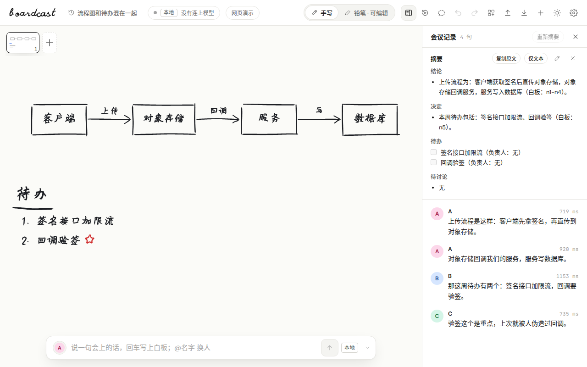

<div align="center">

# boardcast

**说话，板书自己长出来。**

本地语音识别 · 实时手绘板书 · 会议回放与导出

[官网](https://hsiangnianian.github.io/boardcast/) · **[下载桌面版](https://github.com/HsiangNianian/boardcast/releases/latest)** · [更新日志](CHANGELOG.md)

[](https://github.com/HsiangNianian/boardcast/releases/latest) [](https://github.com/HsiangNianian/boardcast/actions/workflows/eval.yml) [](LICENSE)

[English](README.md) · **中文**

</div>

<picture>
  <source media="(prefers-color-scheme: dark)" srcset="docs/screenshot-chalk.png">
  
</picture>
<p align="center"><sub>旧版应用里的一张板。现在的应用画出的板书一样，外面的窗口有所不同。</sub></p>

boardcast 把讨论变成一张持续生长的白板：流程、要点、分工、问题和临时否掉的方案，都能随对话写上去、连起来、划掉。你也可以导入论文或截图，一边讨论，一边在原文上圈画。

默认在本机完成语音识别和板书模型推理。模型下载好后可以离线开会；需要更大的模型时，也能连接 OpenAI 兼容接口。

桌面版是用 Rust 和 [GPUI](crates/README.md) 重写的原生应用。之前的 Tauri 版已经不再发布，它的一些功能[现在的应用还没有](#现在的应用还没有)。

[开始使用](#开始使用) · [能做什么](#能做什么) · [快捷键](#快捷键) · [模型与隐私](#模型与隐私) · [开发](#开发与评测)

## 开始使用

1. 从 [Releases](https://github.com/HsiangNianian/boardcast/releases/latest) 下载安装包。各个包里的应用相同，区别只在内置的语音模型：

   | 安装包 | 能识别 | 语音模型 |
   |---|---|---|
   | `…-macos.zip`、`…-linux.tar.gz`、`…-windows.zip` | 日语、英语和中文，各用最合适的模型 | 约 1.1 GB |
   | `…-ja` | 日语，用 ReazonSpeech | 约 160 MB |
   | `…-en` | 英语，用 Parakeet | 约 660 MB |
   | `…-macos-none.zip` | Mac 自带识别器支持的语言 | 无 |

   每个安装包还都带着会议搜索用的模型，约 334 MB。目前提供 macOS（Apple Silicon 和 Intel）、x64 的 Linux 和 x64 的 Windows 安装包。

2. **macOS：** 应用只做了临时签名，第一次打开请按住 Control 点击 › 打开。**Linux：** 解压后运行 `./install.sh`（装到 `~/.local`，不需要 root；`--uninstall` 卸载并保留数据）。之后的版本会自动安装。**Windows：** 解压后运行 `bin\boardcast.exe`；没有安装程序，暂时也不会自动更新。
3. 第一次启动时，设置会停在**板书模型**：下载一个在本机运行的模型，或者设置远程模型。语音识别已经内置。
4. 点**开始收音**（或按 `空格`），也可以在转写下方的输入框里打一句话，回车上板。

安装版启动后不久会检查新版本，在后台安装，等你重启后生效，不会打断正在开的会。

## 能做什么

| 开会时 | 开完会 |
|---|---|
| **边说边画**：流程、话题、层层嵌套的条目、问题、公式和批注都在同一张板上。 | **摘要**：把结论、决定和待办整理成摘要，可以修改、勾选和复制。 |
| **圈着说**：先圈住东西，再说「把这两个连起来」或「这个打星」，模型就知道你指的是什么。 | **回放与分叉**：看板书一步步长出来，可以拖动、变速，或者从任一时刻另起一张板。 |
| **改正板书**：选中内容后可以划掉、圈出、下划线、星标、高亮，也可以改字或删除，全都可以撤销和重做。 | **追溯谁说了什么**：鼠标移到说话人上，板上属于他们的部分会突出；从条目可以跳到对应的原话。 |
| **按声音区分说话人**，并改成真名；同一个声音之后都沿用这个名字。 | **找回会议**：在侧栏里找到之前的会，或者搜索全部会议，接着开。 |

板书按笔顺一笔一笔写出中文、日文和英文。浅色是白板马克笔；系统为深色时，画布变成粉笔黑板。界面语言是英文或中文，跟随系统或在设置里选择；板书和摘要跟随会议本身的语言。

### 圈着说

点画布下方工具条里的**圈选**，然后在板上拖动画圈。可以画多个圈；中心落在圈里的东西都会被圈住，最多 8 个。下一句话（说出来或打出来）会带着这些对象交给模型，然后圈消失。按 `Esc` 或再点一次取消。圈不会进入板书，也不会出现在导出里。

### 带着资料讨论

用侧栏里的**导入**，或者把文件拖到板上：

| 资料 | 可以做什么 |
|---|---|
| **PDF / 论文** | 每页一张板，原页面垫在下面。标注词、句和段落；把区域连起来，写批注。 |
| **arXiv** | 贴链接或论文编号，下载 PDF。 |
| **PNG / JPEG / WebP / GIF** | 用本地看图组件读出截图或白板照片里的文字。 |

### 把会议带走

| 导出 | 用途 |
|---|---|
| **Markdown** | 要点、Mermaid 流程图和会议记录。 |
| **PNG / SVG** | 当前这张板，和画面上一样；SVG 放大不糊。 |
| **动态 SVG** | 当前这张板，按会议顺序逐笔写出。 |
| **回放网页** | 一个 `.html` 文件，发给没参会的人，双击就能看。 |
| **整场会 PDF** | 每张板一页，后面是摘要和会议记录，文字可以选中复制。 |

无论窗口是什么主题，导出都是白纸马克笔。

### 线上会议和录音

在**设置 › 语音 › 收音来源**里选择麦克风；在 Linux 上也可以选播放会议声音的扬声器或耳机对应的 **Monitor of …** 输入，这样就能收到线上会议里对方的声音，或者播放器里正在放的录音。一次只收一个来源。在 Mac 上，任何安装包都可以在同一处改用 Apple 自带的识别器。

### 现在的应用还没有

下面这些旧版有，还没有在新版里重做：用 Excalidraw 自由编辑和导出、术语表与读音纠错（[#117](https://github.com/HsiangNianian/boardcast/issues/117)）、同时收麦克风和系统声音、macOS 的系统声音（[#34](https://github.com/HsiangNianian/boardcast/issues/34)）、Windows 安装包、全局收音快捷键和诊断包。

## 快捷键

焦点在画布上时生效，不影响输入框。macOS 上用 `Cmd` 代替 `Ctrl`。

| 按键 | 作用 |
|---|---|
| `空格` | 开始 / 停止收音 |
| `/` | 输入一句话 |
| `Esc` | 清除圈选或选中，或者关闭页面或对话框 |
| `Ctrl+Z` / `Ctrl+Shift+Z` | 撤销 / 重做 |
| `Ctrl+=` / `Ctrl+-` / `Ctrl+0` | 放大 / 缩小 / 适应屏幕 |
| `M` | 显示或收起板书小地图 |
| `Ctrl+Shift+R` | 回放；回放中 `空格` 播放或暂停，`←` `→` 逐步，`Esc` 退出 |
| `Ctrl+N` | 新建会议 |
| `Ctrl+K` | 搜索会议 |
| `Ctrl+B` | 显示或收起侧栏 |
| `Ctrl+,` | 打开设置 |

## 模型与隐私

应用内置 llama.cpp 的 `llama-server` 并替你管理：Linux 用 Vulkan，macOS 用 Metal，必要时退回 CPU。在**设置 › 板书模型**里选择：

| 模型 | 下载大小 | 说明 |
|---|---|---|
| **Qwen3.5-4B · Q4_K_M** | 约 2.7 GB | 默认；笔记本和集成显卡都能用。 |
| **Qwen3.5-9B · Q4_K_M** | 约 5.7 GB | 更大；建议 6 GB 以上显存。 |

下载可以暂停和续传，会检查剩余空间并校验 SHA-256，依次尝试 ModelScope、hf-mirror 和 Hugging Face。第一次启动会为显卡编译着色器，大约半分钟，只需一次。

- **会议搜索**：用自己的话提问，就能在所有会议里找到相关的那段。用的是 [EmbeddingGemma 300M](https://huggingface.co/google/embeddinggemma-300m)，每个安装包都自带，在本机运行，遵循 [Gemma 使用条款](https://ai.google.dev/gemma/terms)。默认打开，可以在**设置 › 通用**里关掉；第一次启动会给所有会议建索引，需要一些时间。
- **默认本地**：音频在本机识别，会议也留在本机。不需要账号或 API key。
- **按需远程**：在**远程模型**里填 OpenAI 兼容的地址、模型和 key，或者一键填写 DeepSeek，然后**测试连接**并**保存**。发给该服务的是每句话、说话人名字和板书文字，不发送音频。
- **key 的保存**：key 存在设置目录的 `remote.json` 里，只有你自己能读，也不会写进日志。

| | 会议与模型 | 设置（`remote.json`） |
|---|---|---|
| Linux | `~/.local/share/games.mmstudio.boardcast/` | `~/.config/games.mmstudio.boardcast/` |
| macOS | `~/Library/Application Support/games.mmstudio.boardcast/` | 同一个目录 |

可以用 `BOARDCAST_DATA` 和 `BOARDCAST_CONFIG` 改到别处。

## 开发与评测

桌面版是一个 Cargo workspace，各 crate 的分工见 [crates/README.md](crates/README.md)。在 Linux 上请安装 CI 用到的这些包（Debian / Ubuntu）：`pkg-config libxkbcommon-dev libxkbcommon-x11-dev libwayland-dev libx11-xcb-dev libxcb1-dev libvulkan-dev libasound2-dev libssl-dev libzstd-dev libfontconfig-dev libfreetype-dev`。

```sh
git clone https://github.com/HsiangNianian/boardcast.git
cd boardcast
cargo run --release -p boardcast-ui     # 桌面版
cargo test --workspace
sh packaging/linux/package.sh           # target/package/boardcast-<version>-<arch>-linux.tar.gz
```

全部代码都是 Rust，官网也一样：用 [Trunk](https://trunkrs.dev) 构建（`cd landing && trunk serve`），见 [landing/README.md](landing/README.md)。

<details>
<summary><strong>评测</strong></summary>

| 用例集 | 当前规模 | 用途 |
|---|---|---|
| [`eval/cases.json`](eval/cases.json) | 28 场会 | 开发与回归，包含英文和一场真实会议的回归 |
| [`eval/holdout.json`](eval/holdout.json) | 27 场会 | 不参与提示词调整的留出集 |
| [`eval/pointing.json`](eval/pointing.json) | 18 个用例 | 中英文圈着说，起始板固定 |
| [`eval/revisions.json`](eval/revisions.json) | 3 个用例 | 转写修订，必须保留节点身份和无关内容；等 GPUI 版支持转写修订后再跑 |

先启动可用的 llama-server，然后运行：

```sh
cargo run --release -p boardcast-tools -- agent-eval . board.json --llm http://127.0.0.1:8080 --set dev --label my-model
cargo run --release -p boardcast-tools -- agent-eval . board.json --llm http://127.0.0.1:8080 --set holdout --label my-model
cargo run --release -p boardcast-tools -- agent-eval . board.json --llm http://127.0.0.1:8080 --set pointing --repeat 3 --label my-model
```

语音识别有自己的评测：

```sh
cargo build --release -p boardcast-asr-eval
target/release/asr-eval download . --suite quick   # 下载并校验录音，生成试听页面
target/release/asr-eval run . --suite quick        # 用新版自己的识别流程跑，按语言打分
target/release/asr-eval run . --suite meetings     # 9 段约 10 分钟、跨行业的会议录音；需要 ffmpeg
```

各配置、参考文本质量和[数据集许可](eval/asr/LICENSES.md)见[语音评测](eval/asr/README.md)。CI 在 [Eval](.github/workflows/eval.yml) 工作流里用 Qwen3.5-4B 运行这些评测。模型可能漏掉内容、连错对象或看错重点，识别质量也会影响结果，重要结论请再核对。

</details>

<details>
<summary><strong>发布</strong></summary>

提高 workspace 版本号并合并，然后推送一个带注释的 tag，注释就是发版说明：`git tag -a v<version> -m "…"`，再 `git push origin v<version>`。[Release](.github/workflows/release.yml) 工作流随即构建 Linux（all、ja、en）和 Mac（Apple 芯片与 Intel，各 all、ja、en、none）的全部安装包、写出更新清单，并把 `v<version>` 发布为最新版本，安装版就从这里检查更新。带预发布部分的版本（如 `0.23.0-1`）发布为预发布版，不会推送给已安装的用户。提交信息使用 Conventional Commits；每个版本记录在 [CHANGELOG.md](CHANGELOG.md)。

</details>

## 参与与许可

在 [Issues](https://github.com/HsiangNianian/boardcast/issues) 里报告问题或讨论想法，也欢迎直接提 PR。

代码使用 [MIT](LICENSE) 许可。中文笔画数据来自 [hanzi-writer-data](https://github.com/chanind/hanzi-writer-data)，源自 Make Me a Hanzi 和文鼎字体，采用 Arphic Public License，许可证随生成的数据一起分发。日文假名和补充汉字来自 Ulrich Apel 的 [KanjiVG](https://kanjivg.tagaini.net/)，改为中心线后以 [CC BY-SA 3.0](assets/licenses/kanjivg-CC-BY-SA-3.0.txt) 分发。默认的英文和数学符号笔画源自 Excalifont，采用 [SIL OFL](assets/licenses/handwritten-OFL.txt)；另有部分数学符号来自内置的 Cascadia Code 字体，见其[附带许可](assets/licenses/handwritten-cascadia.txt)。潦草时的英文连写来自 [hersheytext](https://github.com/techninja/hersheytextjs) 里的 Hershey 连写体，采用 [MIT](assets/licenses/hersheytext-MIT.txt)。桌面版内置 DM Sans 和 JetBrains Mono，采用 SIL OFL（见 [crates/ui/fonts](crates/ui/fonts)）。官网使用 DM Sans、JetBrains Mono 和未修改的 Excalifont 拉丁子集，均采用 SIL OFL，见 [landing/public/licenses](landing/public/licenses)。
