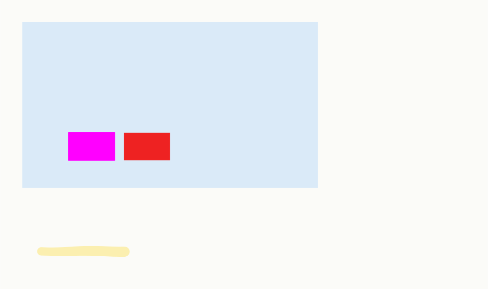
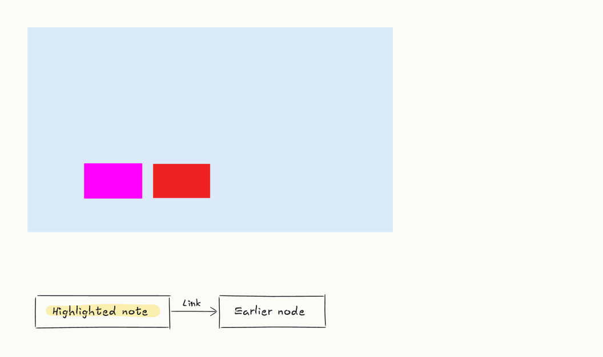

# C48 动态 SVG 顺序、终态与静态宿主

2026-11-06，PR #79 的 `d69409b` 基线。生产旧版实际下载的 28 项检查有 5 项失败；修复后连同两项中英文紧凑菜单说明检查，共 30 项通过。产品改动集中在 `src/ink/animate.ts` 和两处导出说明，另修正 CI 指出的输入预览固定数组用法。

## 复现与修复

| 用户可见问题 | 原因与改动 |
| --- | --- |
| 重叠笔迹或后来添加的高亮，播放终态与静态 SVG 不同 | 播放排序同时改变了 SVG 的叠放顺序。按会议轮次计算时间后，仍按原画布顺序输出；高亮保持在笔迹下层。 |
| 只有来源高亮的几轮操作一次性出现 | 原时间轴只给普通笔迹推进轮次。高亮也参与轮次间隔和 12 秒总预算，笔迹本身仍瞬时显现。 |
| 静态查看器只显示底图、自由对象和高亮，语义笔迹为空 | 原始遮罩默认隐藏所有笔迹，依赖动画露出。现在默认显示全貌，播放时由 CSS 关键帧控制逐笔揭示；减少动态保持完整静态画面。 |

静态 librsvg 查看同一份实际下载文件，左侧问题与修复后的完整画面如下：

## 验证

- **逻辑对照：** 两项新增回归在旧实现失败，最终动画与高亮 14 项通过；完整 Node/Eval 341 项通过。覆盖输入绘制顺序与出现时间独立、只含高亮的轮次、100 轮压缩进总预算。
- **独立渲染对照：** 调用真实生成器的重叠彩色笔迹、高亮和纯高亮样本，旧实现有叠放差异或无时间进展；新实现的自然终态和禁用动画结果均与静态参考一致。早期未挂载 image 的探针不能代表正常播放，已单独保留为无效观察，未计入验收。
- **生产 App 30 项：** 实际 IndexedDB、菜单和 SVG 下载，覆盖混合语义/高亮/底图/自由图形/PNG、仅来源高亮、仅自由对象三张板。自然播放、减少动态的 image、减少动态的独立 SVG 文档和 librsvg 静态输出均通过；12 秒预算、无脚本、原会议字节不变已核对；640×400 中英文导出菜单在操作前说明自由绘图保持静态，文案完整可见。像素比较容忍每通道 10/255 的遮罩抗锯齿差异，超过此值的差异像素为 0。
- **既有回归：** 七格式导出 92 项、外观与笔迹 82 项通过；完整 TypeScript、播放器及主应用构建通过。此次没有改会议格式、模型请求和播放器逻辑。
- **CI 修正：** [Linux Clippy](https://github.com/HsiangNianian/boardcast/actions/runs/42176223890/job/127755591623) 报告 `voice_preview.rs` 的两元素 `Vec` 多余，改用固定数组；所有读写仍按既有的两路索引。`cargo clippy --offline --locked --manifest-path src-tauri/Cargo.toml --lib --release -- -D warnings` 与格式检查通过；输入预览 2 项 Rust 通过、1 项需要虚拟音源的测试未执行。未重跑全部 Rust 或实际音频流。

[新增脚本](../../scripts/ui/check-animated-export.cjs)复用既有 Playwright 安装和系统 Chromium，额外需要 `rsvg-convert`；具体命令见 [回归说明](../../scripts/ui/README.md)。基线、实际下载和报告保存在本地 [证据目录](evidence/implementation/animated-export/)，原始证据不随 PR 上传。

## 宿主与测试边界

本次使用 Chromium 152.0.7977.75 和 librsvg 2.62.3。仅用 Playwright 页面级 `reducedMotion` 时，当前 Chromium 的独立 SVG 文档与 `` 内 SVG 表现不同；因此 image 检查同时使用独立浏览器的 `--force-prefers-reduced-motion` 和 context 的 `reducedMotion: reduce`，实际断言文档媒体条件、零动画、完整像素及 350 ms 后不变化。没有修改用户的系统设置，也没有把仅页面模拟结果当作操作系统设置的验收。

[SVG 2 的宿主模式](https://www.w3.org/TR/SVG/latest/conform.html)区分支持动画与静态处理；[Playwright 媒体模拟说明](https://playwright.dev/docs/emulation#media-type-and-color-scheme)说明页面级模拟。这里的 Chromium image 差异来自本次实测，不据此推断所有浏览器行为。

未验证 GitHub/聊天软件的实际图片代理、Safari、物理设备的减少动态设置或所有静态渲染器；GIF/WebM 仍归原 issue 范围。`d69409b` 的 Windows ARM CI 已通过构建、随包服务 smoke 和 Rust 测试，已生成测试安装包（见 [ARM 后续进展](windows-arm-local-model-validation.md)）；当前提交仍需对应的新 CI。原 Adreno 机器、Mac 实机、实际升级和完整 G3/G4 继续保留。PR 维持 Draft。
