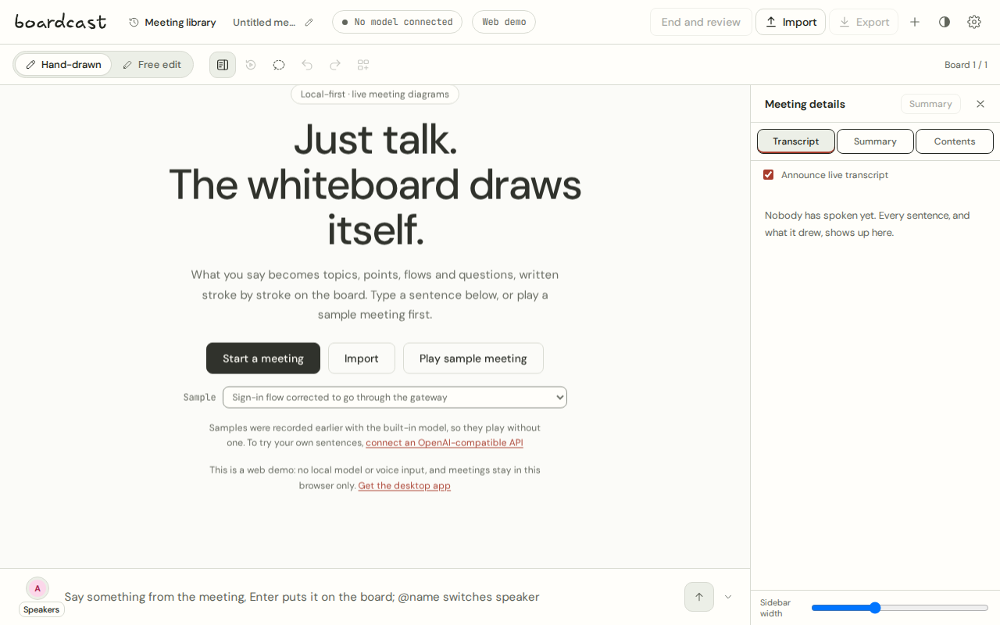
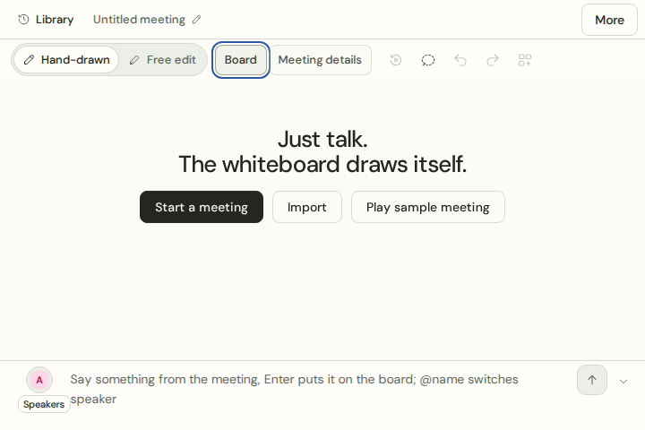

# UI/UX 重构 PR 审查说明

2026-11-06，基于 `main` 的 `4f9ab26a46f07cc5575460fd7431f1a995e705cc`。本次为草稿 PR，可审查代码与交互；完整 C01–C68 / G1–G4 验收未结束，不据此发布或关闭全部关联问题。

## 提交内容与建议审查顺序

1. **会议数据与生命周期。** `src/engine/session.ts`、`meetingSave.ts`、`src/meetings.ts` 和原生 `meetings.rs`：停止/收尾/保存屏障、迟到任务隔离、只读救援、删除竞争、缺附件与版本冲突保护。v2 自由场景使用独立存储，保留 v1 原件和旧版本变更的恢复入口。
2. **会议工作台。** `App.tsx`、`SettingsPanel.tsx` 和 `src/ui/`：手绘/自由编辑、原话/摘要/内容、紧凑顶栏、会前准备、保存反馈、设置分类、统一对话框和键盘焦点。自由对象编辑进入保存、撤销、重开和回放；导入、检索、术语和七格式导出接入同一流程。
3. **桌面恢复与本地请求。** 原生保存/导出/更新/下载/托盘/快捷键、输入预览和中英文错误恢复；桌面本地模型预热、板书、摘要、兜底与图片理解统一走原生 IPC。180 秒预热超时可取消并从模型管理重试。具体诊断边界见 [Windows ARM 报告](windows-arm-local-model-validation.md)。X11 快捷键的最小 vendor 补丁和移除条件见 [说明](../../src-tauri/vendor/global-hotkey/BOARDCAST-PATCH.md)。
4. **回归与设计依据。** [方案](refactor-plan.md)、[实施记录](implementation-progress.md)、[浏览器脚本](../../scripts/ui/README.md)和各专题报告。提交按产品实现、回归资料和后续修复组织；没有增加新的前端运行时依赖或变更发布版本。

## 本次 PR 准备时重新执行

| 检查 | 结果与边界 |
| --- | --- |
| `pnpm test` | 341 项通过，0 失败、0 跳过（含动态 SVG 续批）。 |
| `pnpm eval:phonetic` | 45/45 通过；合成中英日文本，不是音频识别或真实模型质量测试。 |
| `cargo test --offline --locked --manifest-path src-tauri/Cargo.toml --lib` | 80 项通过，12 项显式忽略。忽略项需要外网服务、模型/音频语料、实际设备、隔离音频或满盘环境，不计为通过。 |
| `cargo fmt --manifest-path src-tauri/Cargo.toml -- --check` | 通过。 |
| 完整 `build` 脚本 | 字形准备、TypeScript、独立播放器和主应用均通过。使用隔离源文件副本和已有依赖；临时目录下关闭 pnpm 的自动依赖重装检查，未修改项目配置。现有大 chunk 警告仍在。 |
| 生产构建浏览器回归 | 工作台四种尺寸、场景往返、会话生命周期、本地请求通道四组通过。后者 10 项覆盖阻断 WebView fetch、真实 App 生成与保存、180 秒超时取消、重启和服务切换；原生 IPC 为受控 fixture，不是 Windows 真机。 |
| 回归脚本语法 | 84 个 CJS、10 个 Python 文件通过语法检查。 |
| 提交内容 | `git diff --check` 通过；原始诊断 ZIP、模型、构建产物和原始证据目录不提交。 |

本次未重跑每一份历史专题报告。近期专题结果包括 Markdown 下载/渲染 24 项、七格式导出 92 项、交接 70 项，以及 Linux 原生保存、菜单、输入、模型和冷启动检查，范围与构建身份分别记录在 [实施记录](implementation-progress.md)及其链接中。它们不能替代其他平台验收。

[C48 续批](animated-export-validation.md)另补 30 项实际 SVG 下载/宿主检查、92 项七格式和 82 项外观回归；严格 release Clippy 与输入预览 2 项 Rust 检查通过（1 项虚拟音源测试未执行）。[C47 SVG 标题](svg-title-validation.md)补齐 36 项下载/XML/无障碍树检查，并在其最终构建重跑上述三组浏览器回归与 341 项 Node。GitHub 的 `503b677` 已通过前端、Linux x64、macOS ARM、Windows x64/ARM 构建/测试和三组 ASR；文字生成评测仍在运行。SVG 标题提交仍需新的 CI 结果。CI 构建不替代真实音源、升级和设备验收。

## 仍需完成的验收

- **Windows ARM：** `503b677` 已生成包含本地模型修复的 CI 测试包（见 [ARM 报告](windows-arm-local-model-validation.md)）；在用户的 Adreno 机器重测预热、生成、摘要、取消和重启，后续提交仍需对应的新构建。现有 `0.21.1-5` 不包含本次修复；诊断不足以排除额外 GPU/驱动问题。
- **G3：** 用户暂无测试 Mac。macOS 原生音源/权限、Apple 转录、VoiceOver、真实长会议与签名更新，以及其他平台的物理设备组合仍待测试。
- **安装与升级：** 新安装包、实际版本升级和重新启动尚未作为本次 PR 的整链路验收完成。
- **完整矩阵与 G4：** 各报告保留未测变体，包括其他输入法、物理触控和辅助功能；至少 5 位新用户的任务试用尚未执行。部分 Linux AT-SPI 定向聚焦仍会触发底层异常，已记录恢复路径，不宣称根因解决。

## 可见结果与证据保存

两图来自本次隔离生产构建与合成空会议。约 844 MB 的原始截图、日志、导出样本和哈希清单保存在原工作区 `evidence/`，未上传仓库；历史报告的相关相对链接只在该工作区有效。可复跑的浏览器脚本及其依赖说明随 PR 提交。
